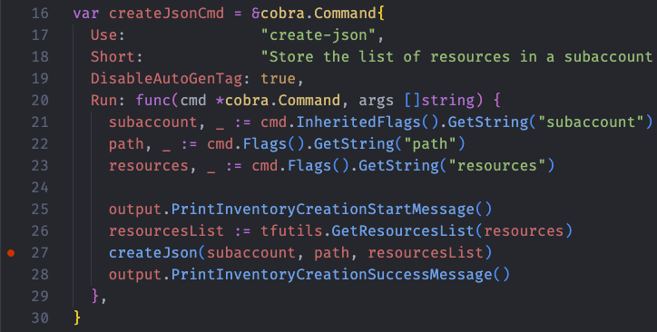
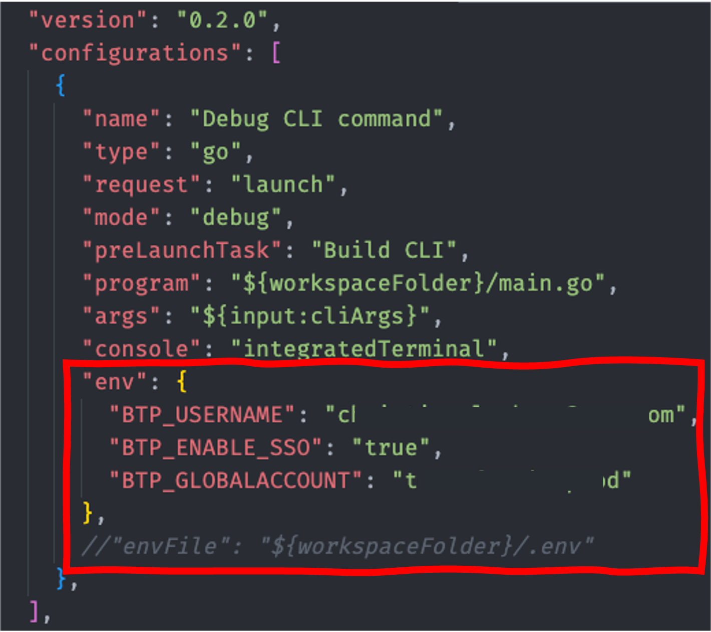
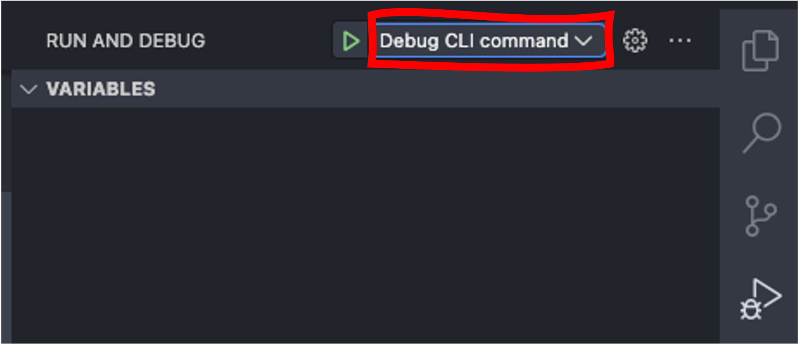
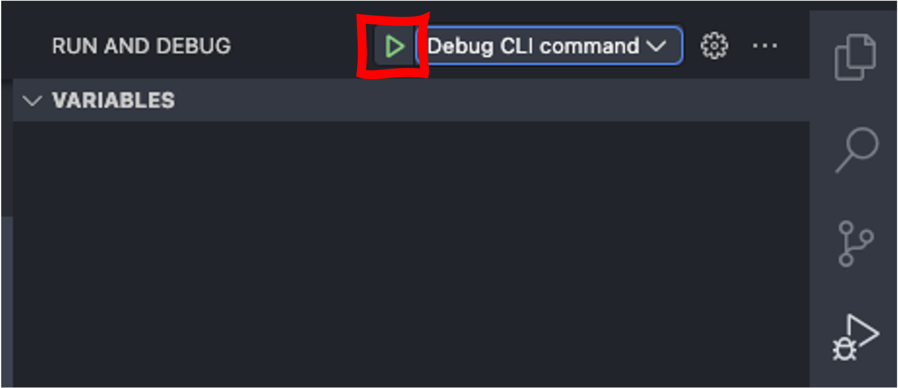
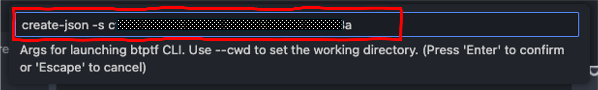
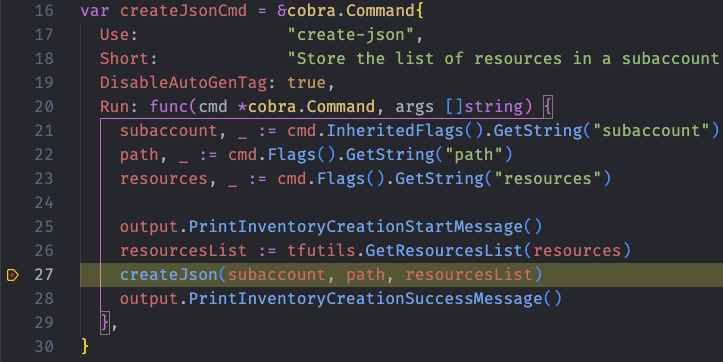

# Developer Guide

## Debugging Output

By default the CLI suppresses the verbose output of the different Terraform commands. However, they might be quite useful, when it comes to analyzing issues. For that you can add the `--verbose` flag to any command of the CLI, which will result in the full output of any `cmd.exec()` execution suppressing any "UI candy" like spinners.

## Debug the CLI

We provide a configuration for debugging the `btptf` commands in VS Code. The configuration is available in the `.vscode` directory as `launch.json`

Here is an example of how to debug the command `btptf create-json`:

1. Set a breakpoint in the file `cmd/createJson.go` in the run section of the command:

   

1. Adjust the `launch.json` configuration to consider your environment variable values. The default is an `.env` file in the root folder (=working directory) of the repository:

   

   > [!WARNING]
   > The environment values will be displayed as clear text in the debug console. If you are using your password as an environment parameter this will become visible when you start debugging. We therefore highly recommend using the env-file option.

1. Open the debug perspective in the VS Code side bar:

   

1. Select the configuration `Debug CLI command`:

   

1. Run the selection by pressing the green triangle:

   

1. VS Code will prompt you for the command via the command palette. It defaults to `resource all -s`. Enter the command and the parameters that you want to use for the command execution. In our case we add a subaccount ID and confirm by pressing `Enter`:

   

1. The debugger will start and hit the breakpoint:

   

Happy debugging!

## Generate Markdown Documentation

When updating command descriptions, you must generate the markdown documentation via the make file:

```bash
make docs
```

## Adding support for New Resources on Subaccount Level

To enable new resources on the subaccount level, you must execute the following steps:

1. Add the corresponding *constants* for the command parameter and the technical resource name in the `tfutils/tfutils.go` file.
1. Add the *mapping of the constants* into the function `TranslateResourceParamToTechnicalName` in the `tfutils/tfutils.go` file.
1. Add the command constant to the slice of `AllowedResources` in the `tfutil/tfconfig.go` file.
1. Add a descriptor to `listResourceSpecs` in `pkg/tfutils/tfQuery.go`.
1. Add the provider-specific query filters to `queryFilters`.
1. Add an inventory identity mapping to `inventoryValue`.
1. Add any platform-default exclusion to `filterQueryResults`. Terraform generates the resource and import blocks; do not add handwritten import templates.

### Adding Unit Tests

The main query logic is located in `pkg/tfutils/tfQuery.go`. Unit tests should cover query HCL, JSON event parsing, inventory identities, filtering, and diagnostics. Provider integration tests should validate representative live query results.

#### Prerequisites

As a prerequisite you should have a Terraform account with the resource that you want to cover in your test up and running. We will use Terraform to extract the base data.

#### Extracting the Data

First create a Terraform setup and `.tfquery.hcl` file that list the resource. The basic provider setup could look like this:

- `provider.tf`:

```terraform
terraform {

  required_providers {
    btp = {
      source  = "SAP/btp"
      version = "~>1.24.0"
    }
  }
}

provider "btp" {
  globalaccount  = "<YOU GLOBALACCOUNT SUBDOMAIN>"
}
```

- Assuming we want to fetch subscriptions, `subscriptions.tfquery.hcl` would look like this:

```terraform
list "btp_subaccount_subscription" "all" {
  provider         = btp
  include_resource = true
  config {
    subaccount_id = "<YOUR SUBACCOUNT ID>"
  }
}

```

Run the query as machine-readable JSON:

```bash
terraform query -json -generate-config-out=generated.tf
```

Use the `list_resource_found` events as fixtures for parser and inventory tests. Avoid fixtures containing credentials or sensitive resource attributes.

## Creating Console Help

We use the custom templating option available in the Cobra Framework to construct the output in the console. The override of the default templating flow is triggered in the commands via the function `SetHelpTemplate` and `SetUsageTemplate`.

In general, we call the `generateCmdHelp` function to generate the output that will be displayed in the console. The `generateCmdHelp` function gets the command as well as a structure of the type `generateCmdHelpOptions`.

If the command receives an empty structure, it will call several default functions to create the console help. However, you have the option to override the single section by providing a custom function that crafts the string used in the console help.

You find an example for this setup in the command `exportByResourceCmd`. Be aware that the code leverages several helper functions that are available in the file `cmdDocsHelper.go`.

## Setting Environment Variables in a Development Container

- Create a file `devcontainer.env` in the `.devcontainer` directory
- Add the environment variables in the file. Here is an example:

   ```txt
   BTP_USERNAME='<MY SAP BTP USERNAME>'
   BTP_PASSWORD='<MY SAP BTP PASSWORD>'
   BTP_GLOBALACCOUNT='<MY SAP BTP GLOBAL ACCOUNT SUBDOMAIN>' #optional
   ```
- Start the devcontainer option `Terraform exporter for SAP BTP - Development (with env file)`. The environment variables defined in the `devcontainer.env` file will be automatically injected.

- Alternative via `.env` file (available on MacOS and Linux only):
- Create a file `.env` in the root of the project
- Add the environment variables in the file. Here is an example:

   ```txt
   BTP_USERNAME='<MY SAP BTP USERNAME>'
   BTP_PASSWORD='<MY SAP BTP PASSWORD>'
   BTP_GLOBALACCOUNT='<MY SAP BTP GLOBAL ACCOUNT SUBDOMAIN>'
   ```

- Execute the following command in a terminal:

   ```bash
   export $(xargs <.env)
   ```

!!! info
    There is no predefined functionality in PowerShell to achieve the same. A custom script is needed.
